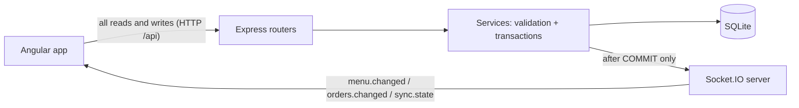
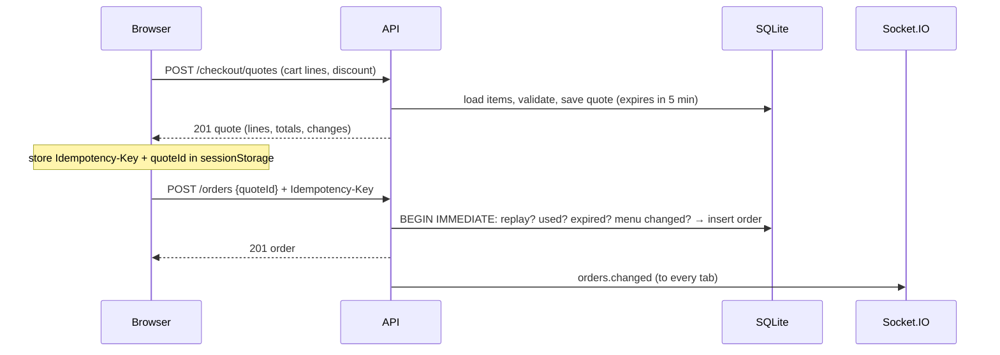
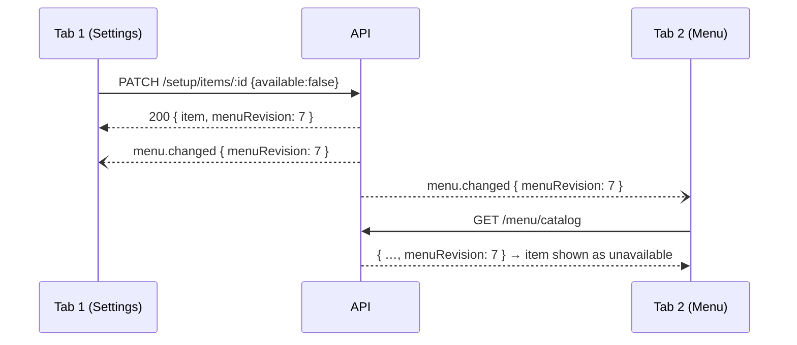
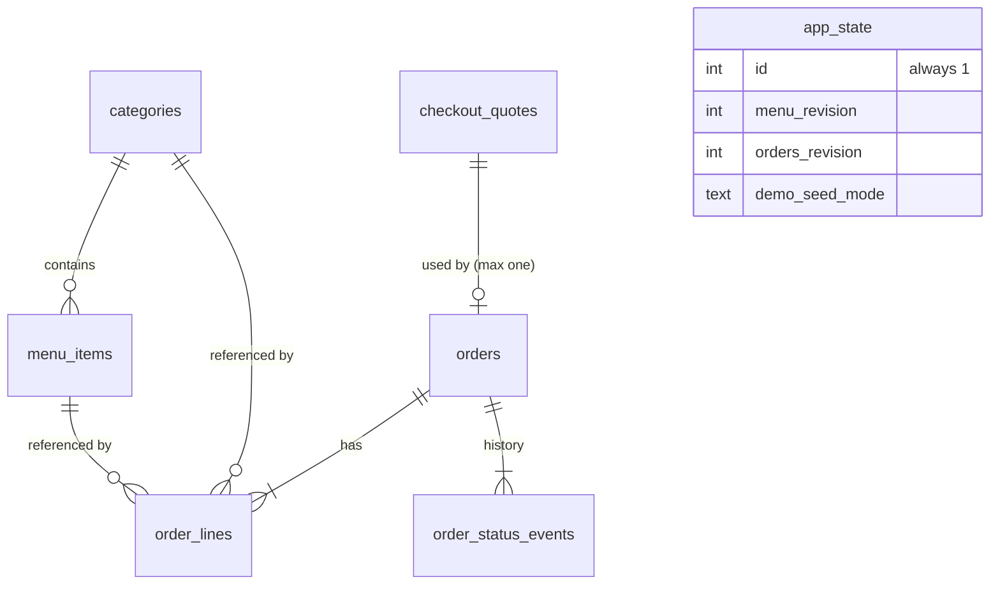

# API, realtime, and database reference

Practical reference for the HTTP API, Socket.IO messages, and SQLite storage. Every example below was captured from the real backend running against a temporary seeded database (`SEED_MODE=small`) on 2026-10-20; UUIDs and timestamps will differ on your machine.

This page describes **what is on the wire and in the database**. For the reasoning behind the rules (why quotes exist, why revisions, consistency bounds), see [contracts](contracts.md) and [architecture](architecture.md). The source of truth for every shape is the Zod schemas in [`libs/contracts/src`](../libs/contracts/src), which both the backend and frontend validate against.

- [1. How it fits together](#1-how-it-fits-together)
- [2. HTTP API](#2-http-api)
- [3. Socket.IO (WebSocket) messages](#3-socketio-websocket-messages)
- [4. Database storage](#4-database-storage)

## 1. How it fits together



- **All writes go through HTTP.** The socket is one-way (server → browser). The browser never sends custom socket messages.
- **Socket events are hints, not data.** An event says "the menu/orders changed, now at revision N". The browser then re-fetches the affected data over HTTP.
- **Two global counters ("stream revisions")** live in the database: `menuRevision` and `ordersRevision`. Every committed menu write bumps `menuRevision`; every order creation or status change bumps `ordersRevision`. Every HTTP read response carries the matching revision, so the browser can tell whether its data is current.
- **Each record also has its own `revision`** (optimistic locking). Edits send `expectedRevision`; if somebody else changed the record first, the server returns `409 REVISION_CONFLICT`.

## 2. HTTP API

### 2.1 Conventions

| Topic | Rule |
| --- | --- |
| Base path | `/api`. In dev the Angular proxy forwards it to `localhost:3000`; in Docker, Nginx forwards it to `backend:3000`. |
| Format | JSON in and out. Unknown fields are rejected (`400`). Max body 64 KiB by default. |
| IDs | UUID v4 strings. |
| Money | Integer **cents** (USD), fields end in `Minor`: `priceMinor: 650` = $6.50. Never floats. |
| Times | UTC ISO strings, e.g. `2026-10-20T12:19:03.800Z`. |
| Paging | `page` (default 1), `pageSize` (default 50, max 100). Responses include `total`, `page`, `pageSize`. |
| Caching | API responses are `Cache-Control: no-store`; images are `public, max-age=3600`. |
| Request ID | Every response has an `X-Request-Id` header; errors repeat it as `error.requestId`. |
| Auth | None. This is a demo; anybody can use every endpoint. |

### 2.2 Error format

Every error has the same envelope:

```json
{
  "error": {
    "code": "REVISION_CONFLICT",
    "message": "This record changed. Reload it before applying your edit.",
    "details": { "entityType": "category", "entityId": "89cabfbb-…", "expectedRevision": 1, "currentRevision": 2 },
    "requestId": "c309c224-ebb9-46ae-bf02-395069adc174"
  }
}
```

| Code | HTTP | When | `details` |
| --- | --- | --- | --- |
| `VALIDATION_ERROR` | 400 | Bad JSON, wrong types, unknown fields, out-of-range values. | `{ issues: [{ path, code, message }] }`; `path` starts with `body` / `query` / `params` / `headers`. |
| `NOT_FOUND` | 404 | Missing record or unknown URL. | `{ resourceType, resourceId }` |
| `REVISION_CONFLICT` | 409 | `expectedRevision` is stale. | `{ entityType, entityId, expectedRevision, currentRevision }` |
| `INVALID_ITEM_TRANSITION` | 409 | Archive an available item, or make an archived item available. | `{ itemId, currentState, requestedState }` |
| `INVALID_STATUS_TRANSITION` | 409 | Order status change not allowed (e.g. `preparing → completed`). | `{ orderId, currentStatus, requestedStatus, allowedStatuses }` |
| `QUOTE_EXPIRED` | 409 | Confirming a quote older than 5 minutes. | `{ quoteId, expiresAt }` |
| `QUOTE_USED` | 409 | Quote already produced an order (with a different idempotency key). | `{ quoteId, orderId }` |
| `MENU_CHANGED` | 409 | Any menu edit happened after the quote was created. | `{ quoteId, quotedMenuRevision, currentMenuRevision }` |
| `IDEMPOTENCY_CONFLICT` | 409 | Same `Idempotency-Key` reused with a different quote. | `{ idempotencyKey }` |
| `CART_INVALID` | 422 | Cart lines that cannot be ordered. | `{ issues: [{ lineIndex, itemId, code, message }] }`; codes: `ITEM_MISSING`, `ITEM_ARCHIVED`, `CATEGORY_ARCHIVED`, `ITEM_UNAVAILABLE`, `OPEN_PRICE_REQUIRED`, `FIXED_PRICE_OVERRIDE` |
| `DISCOUNT_EXCEEDS_SUBTOTAL` | 422 | Discount larger than subtotal. | `{ subtotalMinor, discountMinor }` |
| `CATEGORY_ARCHIVED` | 422 | Creating/moving an item into an archived category. | `{ categoryId }` |
| `SERVICE_UNAVAILABLE` | 503 | DB locked/busy or server shutting down. Has `Retry-After: 1`. | `{ retryAfterMs }` |
| `INTERNAL_ERROR` | 500 | Unexpected failure; no internals exposed. | none |

Example validation error (`GET /api/orders?pageSize=500`):

```json
{
  "error": {
    "code": "VALIDATION_ERROR",
    "message": "Request validation failed.",
    "details": { "issues": [{ "path": ["query", "pageSize"], "code": "too_big", "message": "Too big: expected number to be <=100" }] },
    "requestId": "7ab50318-90fa-4e3e-a54d-b151a9257d52"
  }
}
```

### 2.3 Endpoint list

"UI" shows where the Angular app uses the endpoint. Endpoints marked *legacy* are working and tested but the current UI uses the full catalog endpoints instead.

| # | Method and path | What it does | UI |
| --- | --- | --- | --- |
| 1 | `GET /api/health/live` | Process is running (no DB access). | Docker healthcheck |
| 2 | `GET /api/health/ready` | DB open and migrated; 503 while shutting down. | Docker healthcheck |
| 3 | `GET /api` | API name banner. | — |
| 4 | `GET /api/sync` | Current `menuRevision` / `ordersRevision`. | Every 15 s, on focus/online/reconnect |
| 5 | `GET /api/images/:filename` | Serves a bundled menu image. | Images everywhere |
| 6 | `GET /api/menu/catalog` | All **orderable** categories and items in one snapshot. | Menu page |
| 7 | `GET /api/setup/catalog` | All categories and items **including archived**. | Settings pages |
| 8 | `GET /api/items/:id` | One item + its category (archived too). | Item details page |
| 9 | `GET /api/menu/categories` | Active categories with `availableCount`. | *legacy* |
| 10 | `GET /api/menu/items` | Paged/filtered active items. | *legacy* |
| 11 | `GET /api/setup/categories` | Categories, optionally with archived. | Item editor category picker |
| 12 | `GET /api/setup/items` | Paged/filtered items for management. | *legacy* |
| 13 | `POST /api/menu/resolve` | Current state of specific cart items. | Cart |
| 14 | `POST /api/setup/categories` | Create category. | Settings |
| 15 | `PATCH /api/setup/categories/:id` | Rename, reorder, archive, restore category. | Settings |
| 16 | `POST /api/setup/items` | Create item. | Settings |
| 17 | `PATCH /api/setup/items/:id` | Edit, price change, availability, archive, restore item. | Settings, item details |
| 18 | `POST /api/checkout/quotes` | Price the cart on the server; returns a quote to confirm. | Cart → "Place order" |
| 19 | `POST /api/orders` | Turn a quote into an order (idempotent). | Cart → "Place order" |
| 20 | `GET /api/orders/by-request/:idempotencyKey` | Find the order created by a given checkout attempt. | Cart recovery after reload/timeout |
| 21 | `GET /api/orders` | Paged order list, filter by status/item. | Orders page, item details "orders" tab |
| 22 | `GET /api/orders/:id` | Full order with lines and status history. | Order details page |
| 23 | `PATCH /api/orders/:id/status` | Move order to next status. | Orders page, order details |

Writes 14–17 emit a `menu.changed` socket event; writes 19 and 23 emit `orders.changed`. Nothing else emits events.

### 2.4 Health and sync

**1. `GET /api/health/live`** → `200 {"status":"live"}`

**2. `GET /api/health/ready`** → `200 {"status":"ready"}`, or `503 SERVICE_UNAVAILABLE` when the DB is not ready or the server is shutting down.

**3. `GET /api`** → `200 {"name":"Restaurant Ordering API"}`

**4. `GET /api/sync`** — cheap "has anything changed?" check. The browser compares these numbers with the revisions of the data it has and re-fetches only what is behind.

```json
{ "menuRevision": 9, "menuUpdatedAt": "2026-10-20T12:19:03.812Z", "ordersRevision": 2 }
```

`menuUpdatedAt` is the newest `updated_at` of any category/item (shown in the UI as "menu updated at").

**5. `GET /api/images/:filename`** — serves files from `apps/backend/src/assets/images` (e.g. `/api/images/cake.jpg`). Only flat names matching `[a-z0-9-]+.(jpg|png|webp)`; anything else is `404`. Item `imageUrl` values are either such a path or an external `https://` URL.

### 2.5 Menu reads

**6. `GET /api/menu/catalog`** — everything the Menu page needs, read in one transaction. Contains categories that are not archived, and items that are not archived and whose category is not archived. **Unavailable items are included** (`available: false`) so the UI can show them greyed out. No query parameters; the UI searches, filters, and pages this list locally. Gzip is used when the client accepts it.

```jsonc
{
  "categories": [
    { "id": "e5073782-2689-4439-b710-a59ab14802d7", "revision": 1, "createdAt": "2026-01-01T00:00:00.000Z",
      "updatedAt": "2026-01-01T00:00:00.000Z", "archivedAt": null, "name": "Starters", "sortOrder": 0 }
    // … sorted by sortOrder, then id
  ],
  "items": [
    { "id": "c9aa6e62-8753-4ceb-8079-166af20e8cc8", "revision": 1, "createdAt": "2026-01-01T00:00:00.000Z",
      "updatedAt": "2026-01-01T00:00:00.000Z", "archivedAt": null, "imageUrl": "/api/images/bread.jpg",
      "categoryId": "e5073782-2689-4439-b710-a59ab14802d7", "name": "Bread",
      "description": "Warm artisan bread served with whipped butter.", "available": true,
      "pricingMode": "fixed", "priceMinor": 450 }
    // … available first, then by name
  ],
  "menuRevision": 1,
  "menuUpdatedAt": "2026-01-01T00:00:00.000Z"
}
```

Item fields to know:

- `pricingMode: "fixed"` → `priceMinor` is the price in cents.
- `pricingMode: "open"` → `priceMinor` is `null`; the person ordering types the price (e.g. "Chef special").
- `description` and `imageUrl` are omitted when empty.

**7. `GET /api/setup/catalog`** — same shape as #6, but includes archived categories, archived items, and items in archived categories. Used by Settings to manage everything.

**8. `GET /api/items/:id`** — one item and its category, even if archived. `404 NOT_FOUND` if the ID does not exist.

```jsonc
{
  "item": { "id": "c9aa6e62-…", "name": "Bread", "pricingMode": "fixed", "priceMinor": 450, "available": true, /* … */ },
  "category": { "id": "e5073782-…", "name": "Starters", "sortOrder": 0, /* … */ },
  "menuRevision": 1,
  "menuUpdatedAt": "2026-01-01T00:00:00.000Z"
}
```

**9. `GET /api/menu/categories?search=`** *(legacy)* — active categories, each with `availableCount` (number of orderable items).

```jsonc
{ "categories": [{ "id": "e5073782-…", "name": "Starters", "sortOrder": 0, "availableCount": 6, /* … */ }],
  "menuRevision": 1, "menuUpdatedAt": "2026-01-01T00:00:00.000Z" }
```

**10. `GET /api/menu/items?categoryId=&search=&page=&pageSize=`** *(legacy)* — paged active items. `search` is a case-insensitive substring of the name.

```jsonc
// GET /api/menu/items?categoryId=e5073782-…&page=1&pageSize=2
{ "items": [ { "name": "Bread", /* … */ }, { "name": "Bruschetta", "priceMinor": 700, /* … */ } ],
  "total": 6, "page": 1, "pageSize": 2, "menuRevision": 1, "menuUpdatedAt": "2026-01-01T00:00:00.000Z" }
```

**11. `GET /api/setup/categories?includeArchived=true|false`** — categories for management (default hides archived). Same shape as #9 without `availableCount`.

**12. `GET /api/setup/items?categoryId=&search=&page=&pageSize=&includeArchived=`** *(legacy)* — like #10 but includes unavailable items and children of archived categories; `includeArchived=true` also includes archived items.

**13. `POST /api/menu/resolve`** — the cart asks "what is the current state of these exact items?" regardless of what page the user is on. Read-only. 1–100 unique IDs; results keep request order.

Request:

```json
{ "itemIds": ["c9aa6e62-8753-4ceb-8079-166af20e8cc8", "3b2b8f0e-1d2c-4c3a-9a0e-8a1d2f3e4b5c"] }
```

Response:

```jsonc
{
  "items": [
    { "itemId": "c9aa6e62-…", "state": "available",
      "item": { "id": "c9aa6e62-…", "name": "Bread", "priceMinor": 450, /* full item */ },
      "category": { "id": "e5073782-…", "name": "Starters", /* full category */ } },
    { "itemId": "3b2b8f0e-1d2c-4c3a-9a0e-8a1d2f3e4b5c", "state": "missing" }
  ],
  "menuRevision": 1,
  "menuUpdatedAt": "2026-01-01T00:00:00.000Z"
}
```

`state` is one of `missing`, `archived`, `category-archived`, `unavailable`, `available` (checked in that order). The cart uses this to show red errors (cannot order) or orange price-change warnings (needs acknowledgement).

### 2.6 Menu writes (Settings)

Every successful write increments the record's `revision` and the global `menuRevision` in the same transaction, returns the new `menuRevision`, and then broadcasts `menu.changed`. A write that changes nothing (e.g. restoring an already active record) returns `200` without bumping revisions or sending an event.

**14. `POST /api/setup/categories`** → `201`

```json
{ "name": "Desserts", "sortOrder": 50 }
```

```json
{
  "category": { "id": "89cabfbb-4ee6-4b08-9982-802286e19abd", "revision": 1, "createdAt": "2026-10-20T12:19:03.788Z",
    "updatedAt": "2026-10-20T12:19:03.788Z", "archivedAt": null, "name": "Desserts", "sortOrder": 50 },
  "menuRevision": 2
}
```

`name` is trimmed, 1–120 chars. `sortOrder` defaults to 0.

**15. `PATCH /api/setup/categories/:id`** → `200`. Send `expectedRevision` plus at least one of `name`, `sortOrder`, `archived`.

```json
{ "expectedRevision": 1, "name": "Sweet desserts" }
```

```json
{ "category": { "id": "89cabfbb-…", "revision": 2, "name": "Sweet desserts", "sortOrder": 50, "archivedAt": null, "…": "…" }, "menuRevision": 5 }
```

- `{"archived": true}` archives (hides the category and makes all its items unorderable). `{"archived": false}` restores; child items keep their own archive state.
- Sending the old revision again gives `409 REVISION_CONFLICT` (example in [2.2](#22-error-format)).

**16. `POST /api/setup/items`** → `201`

Fixed price:

```json
{ "categoryId": "89cabfbb-…", "name": "Tiramisu", "description": "Coffee-soaked ladyfingers",
  "pricingMode": "fixed", "priceMinor": 650, "available": true, "imageUrl": "/api/images/cake.jpg" }
```

```json
{
  "item": { "id": "61ff071a-e043-4893-a554-4ec3b64d4c32", "revision": 1, "createdAt": "2026-10-20T12:19:03.790Z",
    "updatedAt": "2026-10-20T12:19:03.790Z", "archivedAt": null, "imageUrl": "/api/images/cake.jpg",
    "categoryId": "89cabfbb-…", "name": "Tiramisu", "description": "Coffee-soaked ladyfingers",
    "available": true, "pricingMode": "fixed", "priceMinor": 650 },
  "menuRevision": 3
}
```

Open price (omit `priceMinor`; response has `"priceMinor": null`):

```json
{ "categoryId": "89cabfbb-…", "name": "Chef special", "pricingMode": "open", "available": true }
```

Rules: price 0–1,000,000 cents; description ≤ 2,000 chars; category must exist and not be archived (`422 CATEGORY_ARCHIVED`).

**17. `PATCH /api/setup/items/:id`** → `200`. Send `expectedRevision` plus at least one change: `name`, `description` (`null` clears), `imageUrl` (`null` clears), `categoryId`, `available`, `archived`, or a pricing pair.

| Goal | Body |
| --- | --- |
| Change price | `{"expectedRevision":1,"pricingMode":"fixed","priceMinor":700}` |
| Switch to open price | `{"expectedRevision":1,"pricingMode":"open"}` |
| Make unavailable | `{"expectedRevision":2,"available":false}` |
| Archive (must already be unavailable) | `{"expectedRevision":3,"archived":true}` |
| Restore (always comes back unavailable) | `{"expectedRevision":4,"archived":false}` |

Item lifecycle: **Available ↔ Unavailable ↔ Archived**. Skipping a step returns:

```json
{ "error": { "code": "INVALID_ITEM_TRANSITION", "message": "Mark this item as unavailable and save before archiving it.",
  "details": { "itemId": "6ed6fdba-…", "currentState": "available", "requestedState": "archived" }, "requestId": "…" } }
```

### 2.7 Checkout

Placing an order is two calls: **quote** (server prices the cart) then **confirm** (server creates the order from that exact quote). The UI chains them from one "Place order" click, but stops and asks the user if the quote shows different prices than the cart displayed.



**18. `POST /api/checkout/quotes`** → `201`. The cart sends what it *believes* (observed revision/price/name); the server recomputes everything from the database and reports differences in `changes`. Prices sent by the client are never trusted, except `openPriceMinor` for open-price items.

Request (the cart saw Tiramisu at $6.50, but it is now $7.00):

```json
{
  "discountMinor": 100,
  "lines": [
    { "itemId": "61ff071a-…", "quantity": 2, "observedRevision": 1, "observedUnitPriceMinor": 650,
      "observedName": "Tiramisu", "comment": "No cocoa" },
    { "itemId": "6ed6fdba-…", "quantity": 1, "openPriceMinor": 1250, "observedRevision": 1 }
  ]
}
```

Response:

```json
{
  "quoteId": "b27ae793-87f4-41b8-83e1-ae1780341ea1",
  "createdAt": "2026-10-20T12:19:03.796Z",
  "expiresAt": "2026-10-20T12:24:03.796Z",
  "menuRevision": 6,
  "lines": [
    { "comment": "No cocoa", "itemId": "61ff071a-…", "categoryId": "89cabfbb-…", "itemName": "Tiramisu",
      "categoryName": "Sweet desserts", "itemRevision": 2, "pricingMode": "fixed",
      "unitPriceMinor": 700, "quantity": 2, "lineTotalMinor": 1400 },
    { "itemId": "6ed6fdba-…", "categoryId": "89cabfbb-…", "itemName": "Chef special",
      "categoryName": "Sweet desserts", "itemRevision": 1, "pricingMode": "open",
      "unitPriceMinor": 1250, "quantity": 1, "lineTotalMinor": 1250 }
  ],
  "subtotalMinor": 2650,
  "discountMinor": 100,
  "totalMinor": 2550,
  "currency": "USD",
  "changes": [
    { "lineIndex": 0, "itemId": "61ff071a-…", "field": "revision", "observed": 1, "current": 2 },
    { "lineIndex": 0, "itemId": "61ff071a-…", "field": "unitPriceMinor", "observed": 650, "current": 700 }
  ]
}
```

Limits: 1–100 lines, quantity 1–99, comment ≤ 500 chars, discount is a flat amount in cents (no percentages, taxes, or tips). Lines that cannot be ordered return `422 CART_INVALID` and **no quote is saved**:

```json
{ "error": { "code": "CART_INVALID", "message": "Correct the indicated cart lines before reviewing.",
  "details": { "issues": [{ "lineIndex": 0, "itemId": "6ed6fdba-…", "code": "OPEN_PRICE_REQUIRED",
    "message": "Enter a price for this open-price item." }] }, "requestId": "…" } }
```

**19. `POST /api/orders`** — header `Idempotency-Key: <uuid>` (required), body `{ "quoteId": "…" }` only.

| Situation | Result |
| --- | --- |
| First successful call | `201` + order; `orders.changed` broadcast. |
| Same key + same quote again (retry after timeout, double click) | `200` + the **same** order; no new order, no event. |
| Different key, quote already used | `409 QUOTE_USED` with `orderId` of the existing order. |
| Same key, different quote | `409 IDEMPOTENCY_CONFLICT` |
| Quote older than 5 minutes | `409 QUOTE_EXPIRED` |
| Any menu write since the quote, or an item/price no longer matches | `409 MENU_CHANGED` (user must review again). |
| Unknown `quoteId` | `404 NOT_FOUND` |

Response (`201`, and identical body on a `200` replay):

```json
{
  "order": {
    "id": "11b65090-3106-481b-8c91-1dfc698ed43f",
    "quoteId": "b27ae793-87f4-41b8-83e1-ae1780341ea1",
    "status": "placed",
    "revision": 1,
    "createdAt": "2026-10-20T12:19:03.800Z",
    "updatedAt": "2026-10-20T12:19:03.800Z",
    "subtotalMinor": 2650,
    "discountMinor": 100,
    "totalMinor": 2550,
    "currency": "USD",
    "history": [{ "status": "placed", "changedAt": "2026-10-20T12:19:03.800Z" }],
    "lines": [
      { "id": "06dd7656-8b39-4d0f-b1a5-98e5de01e34f", "comment": "No cocoa", "itemId": "61ff071a-…",
        "categoryId": "89cabfbb-…", "itemName": "Tiramisu", "categoryName": "Sweet desserts", "itemRevision": 2,
        "pricingMode": "fixed", "unitPriceMinor": 700, "quantity": 2, "lineTotalMinor": 1400,
        "imageUrl": "/api/images/cake.jpg" },
      { "id": "fd670010-5b4d-4a09-bb37-a638cccee715", "itemId": "6ed6fdba-…", "categoryId": "89cabfbb-…",
        "itemName": "Chef special", "categoryName": "Sweet desserts", "itemRevision": 1,
        "pricingMode": "open", "unitPriceMinor": 1250, "quantity": 1, "lineTotalMinor": 1250 }
    ]
  },
  "ordersRevision": 1
}
```

Order lines are **snapshots**: names, prices, and images are copied at order time, so later menu edits never change historical orders.

**20. `GET /api/orders/by-request/:idempotencyKey`** — "did my checkout attempt go through?" Returns the same `{ order, ordersRevision }` as #19, or `404` if no order exists for that key yet. The browser uses this after a reload or network timeout before deciding to retry with the same key.

### 2.8 Orders

**21. `GET /api/orders?status=&itemId=&page=&pageSize=`** — newest first. `status` filters by status; `itemId` returns orders containing that item (used on the item details page). Summaries have no lines, but include up to three `itemImages` for thumbnails.

```json
{
  "orders": [
    { "id": "11b65090-…", "quoteId": "b27ae793-…", "status": "preparing", "revision": 2,
      "createdAt": "2026-10-20T12:19:03.800Z", "updatedAt": "2026-10-20T12:19:03.805Z",
      "subtotalMinor": 2650, "discountMinor": 100, "totalMinor": 2550, "currency": "USD",
      "itemImages": [
        { "id": "61ff071a-…", "name": "Tiramisu", "imageUrl": "/api/images/cake.jpg" },
        { "id": "6ed6fdba-…", "name": "Chef special" }
      ] }
  ],
  "total": 1, "page": 1, "pageSize": 1, "ordersRevision": 2
}
```

**22. `GET /api/orders/:id`** — full order (same shape as #19) with all lines and `history` of status changes.

**23. `PATCH /api/orders/:id/status`** — staff moves the order forward.

```json
{ "status": "preparing", "expectedRevision": 1 }
```

Returns `{ order, ordersRevision }` with `revision` +1 and a new `history` entry, then broadcasts `orders.changed`. Allowed transitions:

```text
placed ──► preparing ──► ready ──► completed
   │           │
   └───────────┴──► cancelled
```

`completed` and `cancelled` are final; `ready` cannot be cancelled. Disallowed moves return `409 INVALID_STATUS_TRANSITION` (with `allowedStatuses`), a stale `expectedRevision` returns `409 REVISION_CONFLICT`, and requesting the current status is a no-op `200` with no event.

## 3. Socket.IO (WebSocket) messages

### 3.1 Connection

| Setting | Value |
| --- | --- |
| URL | Same origin as the page, path `/socket.io` (Nginx/dev proxy forward to the backend). |
| Transports | HTTP long-polling first, upgraded to WebSocket. |
| Library | Socket.IO 4.8.4 server and client. |
| Direction | **Server → browser only.** There are no client → server application messages. |
| Audience | Every event goes to **every** connected tab, including the tab that made the change. |
| Recovery | Socket.IO connection-state recovery for up to 2 minutes (`SOCKET_RECOVERY_MS`), plus the app's own revision re-sync. |

The single connection is owned by `RealtimeSync` ([`apps/frontend/src/app/core/realtime-sync.ts`](../apps/frontend/src/app/core/realtime-sync.ts)); the server side is [`apps/backend/src/modules/realtime/server.ts`](../apps/backend/src/modules/realtime/server.ts).

### 3.2 Messages

| Event | Sent by | When / why | Payload |
| --- | --- | --- | --- |
| `sync.state` | Server | Immediately after **every** connect and reconnect. Tells the tab the current revisions so it can detect anything it missed while disconnected. | `{ menuRevision, menuUpdatedAt, ordersRevision }` |
| `menu.changed` | Server | After a menu write (#14–17) **commits**. Tells tabs the menu is now at a newer revision. | `{ eventId, menuRevision, entityType, entityId, change }` |
| `orders.changed` | Server | After an order is created (#19) or its status changes (#23) **commits**. | `{ eventId, ordersRevision, orderId, orderRevision, change }` |
| `connect` / `disconnect` / `connect_error` | Socket.IO itself | Built-in transport lifecycle. The app uses them for the connection indicator. | — |

**`sync.state`**

```json
{ "menuRevision": 1, "menuUpdatedAt": "2026-01-01T00:00:00.000Z", "ordersRevision": 0 }
```

**`menu.changed`** — `entityType` is `category` or `item`; `change` is `created`, `updated`, or `archived` (restoring sends `updated`).

```json
{ "eventId": "88f5c928-b4d7-4d8e-8e2f-d38a758f6333", "menuRevision": 2,
  "entityType": "category", "entityId": "89cabfbb-4ee6-4b08-9982-802286e19abd", "change": "created" }
```

```json
{ "eventId": "8b2bcf52-1b67-4685-9918-bffe9d111bc5", "menuRevision": 8,
  "entityType": "item", "entityId": "61ff071a-e043-4893-a554-4ec3b64d4c32", "change": "archived" }
```

**`orders.changed`** — `change` is `created` or `status-changed`; `orderRevision` is the order's own revision after the change.

```json
{ "eventId": "2232e850-141c-4e42-9e75-a18e58def08d", "ordersRevision": 1,
  "orderId": "11b65090-3106-481b-8c91-1dfc698ed43f", "orderRevision": 1, "change": "created" }
```

```json
{ "eventId": "60dd3acd-aed5-4113-a376-22cf8bb10567", "ordersRevision": 2,
  "orderId": "11b65090-3106-481b-8c91-1dfc698ed43f", "orderRevision": 2, "change": "status-changed" }
```

Not sent: failed writes, validation errors, no-op writes, and idempotent order replays.

### 3.3 What the browser does with them

Events carry no entity data. The browser only records "the highest revision I know exists" and every data query re-fetches over HTTP when its data is older than that.

| Revision bumped | Who refetches | HTTP call |
| --- | --- | --- |
| `menuRevision` | Menu page | `GET /api/menu/catalog` |
| | Settings pages | `GET /api/setup/catalog` |
| | Cart | `POST /api/menu/resolve` (shows price/availability warnings) |
| | Item details | `GET /api/items/:id` |
| | Checkout | Invalidates an open quote; the next "Place order" creates a new one. |
| `ordersRevision` | Orders list | `GET /api/orders?…` |
| | Order details | `GET /api/orders/:id` |
| | Item details orders tab | `GET /api/orders?itemId=…` |

Example of two tabs:



**Missed events.** Socket.IO delivery is at-most-once, so the browser also calls `GET /api/sync` every 15 seconds while open, on window focus, when the browser comes back online, and after every (re)connect. If a revision there is higher than the data on screen, the same refetches happen. Responses older than an already known revision are discarded, so a slow response can never overwrite newer data.

## 4. Database storage

### 4.1 Overview

| Topic | Value |
| --- | --- |
| Engine | SQLite via `better-sqlite3` (synchronous), queries via Drizzle ORM. |
| File | `data/restaurant.sqlite` locally (`DATABASE_PATH`); `/data/restaurant.sqlite` on the `restaurant-data` Docker volume. |
| Mode | WAL journal, foreign keys ON, 5 s busy timeout (then `503`). |
| Schema | [`apps/backend/src/db/schema.ts`](../apps/backend/src/db/schema.ts); migrations in [`apps/backend/drizzle/`](../apps/backend/drizzle), applied on startup before the server listens. |
| Seeding | On first start of an empty DB per `SEED_MODE` (`small` default: 6 categories / 36 items; `large`; `none`). Never reseeds existing data. Manual: `pnpm db:migrate`, `pnpm db:seed:small`, `pnpm db:seed:large`. |
| Deletes | None. Records are archived (`archived_at`), never deleted. |
| Naming | snake_case columns map to camelCase API fields (`price_minor` → `priceMinor`). Booleans are stored as 0/1, times as ISO text. |

### 4.2 Tables



**`app_state`** — one row (`id = 1`) holding the global counters.

| Column | Meaning |
| --- | --- |
| `menu_revision` | +1 on every committed category/item write. Served as `menuRevision`. |
| `orders_revision` | +1 on every order creation and status change. Served as `ordersRevision`. |
| `demo_seed_mode` | `small` / `large` once seeded; prevents seeding again. |

**`categories`**

| Column | Notes |
| --- | --- |
| `id` | UUID primary key. |
| `name` | 1–120 chars. |
| `sort_order` | Display order (then by `id`). |
| `archived_at` | `NULL` = active; timestamp = archived. |
| `revision` | Starts at 1, +1 per change (optimistic locking). |
| `created_at`, `updated_at` | ISO timestamps. |

**`menu_items`**

| Column | Notes |
| --- | --- |
| `id` | UUID primary key. |
| `category_id` | FK → `categories.id`. |
| `name`, `description`, `image_url` | Name 1–120 chars; description ≤ 2,000; both optional fields nullable. |
| `pricing_mode` | `fixed` or `open`. |
| `price_minor` | Cents; **required** when `fixed`, **must be NULL** when `open` (CHECK constraint). |
| `available` | 0/1. Unavailable items are visible but cannot be ordered. |
| `archived_at`, `revision`, `created_at`, `updated_at` | As for categories. |

**`checkout_quotes`** — server-made price snapshots waiting for confirmation.

| Column | Notes |
| --- | --- |
| `id` | Quote UUID (`quoteId`). |
| `menu_revision` | `menuRevision` when quoted; confirmation fails with `MENU_CHANGED` if the current value differs. |
| `snapshot_json` | The full quote (lines and totals) as JSON, exactly what was shown to the user. |
| `currency` | Always `USD`. |
| `created_at`, `expires_at` | `expires_at` = created + 5 minutes. |

Quotes used by an order are kept forever. Expired unused quotes can be removed with `cleanupExpiredQuotes` ([`db/cleanup.ts`](../apps/backend/src/db/cleanup.ts)), which nothing calls automatically yet, so they currently accumulate.

**`orders`**

| Column | Notes |
| --- | --- |
| `id` | Order UUID. |
| `quote_id` | FK → `checkout_quotes.id`, **UNIQUE**: one quote can create at most one order. |
| `idempotency_key` | Browser-generated UUID, **UNIQUE**: one checkout attempt creates at most one order. Never returned by the API. |
| `request_hash` | SHA-256 of the confirm request; detects the same key used with a different quote. Never returned. |
| `status` | `placed`, `preparing`, `ready`, `completed`, `cancelled`. |
| `subtotal_minor`, `discount_minor`, `total_minor` | CHECK: `total = subtotal − discount`, `discount ≤ subtotal`. |
| `currency`, `revision`, `created_at`, `updated_at` | `revision` +1 per status change. |

**`order_lines`** — immutable copy of each cart line at order time.

| Column | Notes |
| --- | --- |
| `id`, `order_id`, `line_index` | `(order_id, line_index)` unique; index 0–99. |
| `item_id`, `category_id` | FKs to the live menu records (used for "orders containing this item"). |
| `item_name`, `category_name`, `image_url` | Copied at order time; never updated by menu edits. |
| `item_revision`, `pricing_mode` | Item version and pricing type at order time. |
| `unit_price_minor`, `quantity`, `line_total_minor` | CHECK: `line_total = unit_price × quantity`; quantity 1–99. |
| `comment` | Kitchen note, ≤ 500 chars, nullable. |

**`order_status_events`** — status history shown as `history` in order responses.

| Column | Notes |
| --- | --- |
| `id`, `order_id` | FK → `orders.id`. |
| `revision` | Order revision this status belongs to; `(order_id, revision)` unique. |
| `status`, `changed_at` | The new status and when it was set. |

Drizzle also creates `__drizzle_migrations` to track applied migrations (checked by `/api/health/ready`).

### 4.3 What each write does in the database

All writes are short `BEGIN IMMEDIATE` transactions (one writer at a time). The socket event is sent only after `COMMIT`.

| API call | Rows written in one transaction |
| --- | --- |
| Create/edit category | Insert/update `categories` (revision +1); `app_state.menu_revision` +1. |
| Create/edit item | Insert/update `menu_items` (revision +1); `app_state.menu_revision` +1. |
| Create quote | Insert `checkout_quotes`. No revision changes, no event. |
| Confirm order | Look up `idempotency_key` (replay) → check quote (used/expired/menu revision/item eligibility) → insert `orders`, all `order_lines`, first `order_status_events` row (`placed`); `app_state.orders_revision` +1. |
| Change order status | Update `orders.status` (revision +1); insert `order_status_events`; `app_state.orders_revision` +1. |

Reads that return a revision (catalogs, lists, details) run inside one read transaction, so the returned data and its revision always match.

### 4.4 Inspecting the data

```sh
sqlite3 data/restaurant.sqlite \
  "SELECT * FROM app_state;" \
  "SELECT id, status, total_minor, revision FROM orders ORDER BY created_at DESC LIMIT 5;"
```

In Docker the file is on the `restaurant-data` volume; `docker compose down` keeps it and `docker compose down -v` deletes it.
