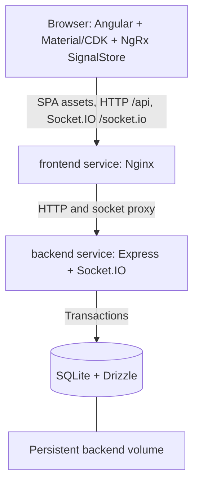

# Architecture

Status: implemented prototype; current verification is recorded in the task index. Product decisions are recorded in [README](README.md). See [contracts](contracts.md) for request/event details and [tasks](tasks/README.md) for work items.

## 1. Goals and boundaries

Deliver the assignment's three flows: Setup configures categories and items; Menu supports a responsive cart and reliable checkout; Orders lists all orders and shows manual status changes live. Multiple browser tabs must see changes without reloading. Losing connectivity must preserve user work and provide a recovery path.

Keep the prototype small: one Angular application, one Express application, one shared contracts library, and one SQLite file. Nx coordinates the workspace and enforces imports; it does not introduce additional runtime services.



## 2. Stack and version policy

| Area | Choice | Reason |
| --- | --- | --- |
| Monorepo | Integrated Nx workspace + pnpm | One lockfile, shared contracts, generated app targets, cached build/test/lint tasks. |
| Frontend | Latest stable Angular; standalone components, signals, lazy routes, OnPush | Small application shell and explicit rendering/state ownership. |
| UI | Angular Material + CDK | Accessible forms, dialogs, tables, progress indicators, and focus management. |
| State | NgRx SignalStore, including entity helpers where useful | Meets the NgRx requirement while keeping feature state compact. RxJS handles requests and socket streams. |
| Backend | Express 5.x, TypeScript strict mode, Zod validation | Small HTTP server with runtime-validated boundaries. |
| Persistence | Drizzle ORM + Drizzle Kit + better-sqlite3 | Typed queries, checked-in migrations, synchronous short SQLite transactions. |
| Realtime | Socket.IO 4.x server/client, matching compatible versions | Reconnection and transport fallback, with application-level resynchronization. |
| Verification | Vitest; real HTTP/fetch integration; Playwright E2E; ESLint | Unit/component tests, real-database HTTP tests, and two-browser flows. |
| Runtime | Node.js 24 LTS line, compatible pinned patch | One Node version for local tooling and backend images; verify native SQLite addon support. |
| Deployment | Docker Compose, Nginx frontend + Node backend | Two independently built images, one browser origin, persistent database. |

T01 resolved and pinned compatible versions; exact dependencies are in `package.json` and `pnpm-lock.yaml`, with Node/pnpm pins in the root README and version files. All Nx packages are aligned and installation enforces peer dependencies. Version research and compatibility evidence are historical in [T01 verification](tasks/t01-scaffold-nx-workspace-and-quality-commands.md#verification); these pins are not a claim about today's latest releases.

Sources: [Angular release policy](https://angular.dev/reference/releases), [Angular runtime/compiler compatibility](https://angular.dev/reference/versions), [Nx/Angular compatibility](https://nx.dev/docs/kb/angular-nx-version-matrix), [Nx Angular plugin alignment](https://nx.dev/docs/technologies/angular/introduction), [NgRx SignalStore](https://ngrx.io/guide/signals), [Drizzle SQLite drivers](https://orm.drizzle.team/docs/sqlite/get-started-sqlite), [Node release status](https://nodejs.org/en/about/previous-releases), [Express 5 API/runtime requirements](https://expressjs.com/en/5x/api/).

## 3. Repository layout and boundaries

Implemented layout (supporting tests/configuration omitted):

```text
apps/
  frontend/
    src/app/
      core/                 # HTTP client, realtime service, app config
      shared/               # Connection dialog and shared presentation
      features/
        menu/               # MenuStore, CartStore, cart UI and browsing
        checkout/           # Quote review, pending confirmation recovery
        setup/              # SetupStore and configuration forms
        orders/             # OrdersStore, list/detail/status controls
    proxy.conf.json
    Dockerfile
    nginx.conf
  backend/
    src/
      main.ts               # Environment, startup logging, process signals
      server.ts             # Migrations, HTTP/socket lifecycle, bounded shutdown
      app.ts                # Express app factory for tests
      config/
      db/                   # Schema, connection, migrations runner, seed
      modules/
        menu/               # Router, service, queries
        checkout/           # Quotes and authoritative validation
        orders/             # Idempotent commit, queries, status transitions
        realtime/           # Socket.IO lifecycle and notifications
      middleware/           # Validation, request IDs, error mapping
    drizzle/                # Generated, reviewed SQL migrations
    Dockerfile
  frontend-e2e/             # Playwright test project; not a deployed service
libs/
  contracts/src/            # DTO schemas/types, errors, event maps
docs/
compose.yaml
.env.example
nx.json
pnpm-workspace.yaml
package.json
pnpm-lock.yaml
```

`frontend → contracts` and `backend → contracts` are the only cross-project application imports. Contracts contain framework-neutral schemas and types; they do not import Angular, Express, Drizzle, or Node-only modules. Never expose database rows directly as public DTOs. Nx tags and ESLint enforce client/server separation. Keep domain folders inside apps initially; extract libraries only when actual reuse justifies them.

Backend routers validate requests and call services. Services own business rules and transaction boundaries; query modules own persistence. Only committed service results cause realtime broadcasts. A shared schema improves consistency but the server independently validates every write.

## 4. Frontend design

Routes: `/menu` (default), `/setup`, `/orders`, and `/orders/:id`. Lazy-load each feature. A shared shell provides navigation and an accessible connection indicator. No sign-in flow or route authorization is included.

| State owner | Contents and lifetime |
| --- | --- |
| MenuStore | Current search/category/page, bounded item entities, categories, menu revision, loading/errors. |
| CartStore / CheckoutStore | CartStore owns line intent, quantity, observed item version/price, open price, and discount; CheckoutStore owns quote review and pending confirmation recovery. Both root-scoped. |
| SetupStore | Current page of configuration data, form submission state, version-conflict messages. Route-scoped. |
| OrdersStore | Current page/filter, visible order versions, order-stream revision, selected order, loading/errors. Route-scoped. |
| Realtime service | One application-wide socket; typed observable events and connection state. No second copy of business entities. |

Keep editing form state local; stores own server data and workflows. Cart totals update immediately with integer arithmetic, while the server supplies authoritative checkout totals. A single adapter routes socket invalidations to interested stores; components do not create sockets or manually subscribe without teardown.

The cart persists validated, versioned JSON in **sessionStorage per tab**, including an unresolved checkout key/quote. This supports reload and retry without adding cross-tab cart coordination. Invalid storage is ignored with a recoverable notice. Storage errors must not crash the UI. Distinct tabs have independent carts; the same reviewed quote still cannot create two orders. Closing a tab ends that cart's persistence.

For large menus, use server-side category filtering, debounced search (~250 ms), and pagination (default 50, maximum 100 items). Do not fetch/render the entire catalogue. Cancel superseded searches and ignore outdated responses. Use stable item IDs for rendering, fixed-size image placeholders if images are later added, and skeletons matching the final layout. No images/uploads are required initially. CDK virtual scrolling is deferred unless profiling shows bounded pages are insufficient.

Menu events refresh the visible page and validate cart items even if they are outside that page. Keep user quantities/open-price input; display changed price, unavailable, or archived states. Refreshing data must not clear the cart, steal focus, or silently submit it. A disconnected state allows browsing cached data and editing the cart; checkout requires a fresh successful server review.

## 5. Data model

All IDs are opaque UUIDs. Timestamps are UTC. Prices, discounts, and totals are integer USD cents throughout DB/API/state. Entity revisions and stream revisions are persisted integers, incremented inside the same transaction as their changes.

| Table | Essential columns and constraints |
| --- | --- |
| `app_state` | Singleton row: `menu_revision`, `orders_revision`, nullable `demo_seed_mode` to prevent reseeding. |
| `categories` | `id`, `name`, `sort_order`, `archived_at`, `revision`, timestamps. |
| `menu_items` | `id`, `category_id` FK, `name`, optional description, `pricing_mode` (`fixed`/`open`), nullable `price_minor`, `available`, `archived_at`, `revision`, timestamps. |
| `checkout_quotes` | `id`, `menu_revision`, validated immutable snapshot JSON, `currency`, `created_at`, `expires_at`. Server-generated only. |
| `orders` | `id`, `quote_id` UNIQUE FK, `idempotency_key` UNIQUE NOT NULL, `request_hash`, `status`, `subtotal_minor`, `discount_minor`, `total_minor`, `currency`, `revision`, timestamps. |
| `order_lines` | `id`, `order_id` FK, per-order unique `line_index`, `item_id`/`category_id` FKs, item/category name snapshots, `item_revision`, pricing mode snapshot, `unit_price_minor`, `quantity`, `line_total_minor`. |

Foreign keys enabled on every connection; WAL mode and a finite busy timeout (initially 5 seconds). Use CHECK constraints for enums, booleans, nonnegative money, positive quantities, and `total = subtotal - discount`. Fixed items require `price_minor`; open items require it to be null. The service also validates all constraints and safe-integer arithmetic. Index item category/archive fields, order creation timestamp plus ID, order status, and quote expiry. Unique indexes on quote/key enforce checkout safety independently of UI state.

Archive categories/items instead of hard deletion. An archived category makes all its items unorderable; unarchiving is outside initial scope. Historical orders retain their names/prices even after menu edits. No inventory decrement: availability is a boolean controlled in Setup. Quote creation does not reserve an item or freeze future availability.

Short `BEGIN IMMEDIATE` write transactions serialize checkout with menu/status writes. With better-sqlite3, perform all transaction work synchronously; no network calls or awaited work inside transactions. Map lock contention to a retryable 503. The backend is a **single replica**; SQLite on a local mounted volume is sufficient for this scope. Multiple replicas/shared network filesystems are outside the design.

Generated migrations are committed and applied before the HTTP listener becomes ready. Never run schema push in deployment. Seed only on an explicitly configured first empty demo database; restarting must not overwrite data. Provide a separate deterministic seed/large-menu command for development and tests. Expired unreferenced quotes may be deleted; retain quotes referenced by orders and retain order idempotency keys for the lifetime of the prototype database.

## 6. Checkout and realtime decisions

All mutations use HTTP. Socket.IO carries post-commit menu/order notifications and connection state. HTTP is also the recovery source. Shared event types cover both server and client. See [contracts](contracts.md) for the exact review/confirm protocol.

The server creates a short-lived persisted quote from current data, then validates that same quote and the menu revision inside the order transaction. A menu change after review prevents confirmation. Persisted unique idempotency keys and unique quote consumption prevent duplicate effects when requests overlap, responses are lost, or clients retry. A disabled button is only a user-experience aid.

Socket notifications are hints to refresh authoritative state. Persisted stream revisions, connect/reconnect snapshots, foreground refresh, and a lightweight 15-second sync check close missed-event gaps. This avoids a durable event broker/outbox for the prototype while documenting a bounded delay if an event is lost after commit. Normal connected updates target under one second; an event-loss recovery can take up to one sync interval plus request time.

Socket.IO's default delivery is at most once; its connection-state recovery can also fail. Neither capability alone provides checkout idempotency or durable synchronization. Sources: [delivery guarantees](https://socket.io/docs/v4/delivery-guarantees/), [connection recovery](https://socket.io/docs/v4/connection-state-recovery/).

## 7. Two-service deployment

| Service | Runtime responsibilities | Network/storage |
| --- | --- | --- |
| `frontend` | Nginx serves built Angular assets; proxies `/api/` and `/socket.io/` to `backend:3000`. | Publish host port 8080 by default. No persistent volume. |
| `backend` | Node runs Express and Socket.IO on the same HTTP server; applies migrations, optionally seeds an empty demo DB. | Internal port 3000; named `restaurant-data` volume at `/data`; SQLite path `/data/restaurant.sqlite`. |

`compose.yaml` defines exactly these two services and the named volume. SQLite is embedded; it is not a third service. Multi-stage builds use the repository root as build context so both apps can consume contracts and the lockfile. better-sqlite3 compiles for the Linux runtime ABI inside the Debian slim Node build image; host `node_modules` is excluded. Both images install frozen dependencies and run as non-root users; the backend user owns `/data`, including a newly initialized named volume.

Frontend assets use relative `/api` and `/socket.io` paths, so one image works on another host without embedding the backend hostname. Nginx preserves the Socket.IO path, supports WebSocket Upgrade and HTTP polling, and uses proxy timeouts longer than heartbeat settings. Deep Angular routes fall back to `index.html`; API/socket errors never fall back to HTML. Cache hashed assets immutably and keep index HTML revalidated.

Readiness: backend `/api/health/ready` checks migrations/database access; liveness `/api/health/live` checks the running process. Frontend has its own health endpoint. Compose waits for backend health before starting frontend; runtime failures still appear as recoverable UI errors. Handle SIGTERM by stopping HTTP/socket intake and closing the DB cleanly. Document that `docker compose down` preserves data and `down -v` deletes it.

Run commands:

```sh
docker compose up --build
```

or, with the documented Node/pnpm prerequisites:

```sh
pnpm install --frozen-lockfile
pnpm dev
```

T01 provides `pnpm install --frozen-lockfile` and `pnpm dev` with the Angular dev proxy. T03 added migration/seed initialization before listening; T04 implemented configuration validation, health checks, error handling, and graceful shutdown, including a lifecycle hook for T08's Socket.IO server. T14 added Docker startup and an isolated `pnpm docker:smoke` deployment test. Defaults require no `.env` copy; the root README and `.env.example` document optional settings. Local DB files and `.env` stay outside version control and are excluded from Docker build contexts.

## 8. Trade-offs and production follow-up

Nx adds tooling for a small repo but gives explicit project boundaries and shared validation. SignalStore avoids a large action/reducer setup while satisfying the assignment's state-management requirement. A synchronous SQLite driver keeps transactions simple; bounded queries and one writer are acceptable for a demo. Any menu edit invalidates all outstanding quotes, which is conservative and may cause an extra review even for an unrelated item change.

No authentication means every visitor can edit Setup, view every order, and update statuses. Deploy this version only as a controlled demonstration. A production iteration needs staff roles and customer ownership, public-edge TLS/access restrictions, payment and inventory policies, abuse controls, backups/restores, database scaling, durable event delivery, observability, and privacy/retention rules. Public launch is outside this implementation backlog.
